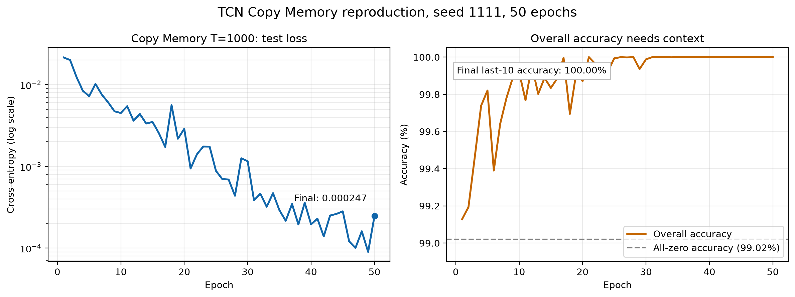
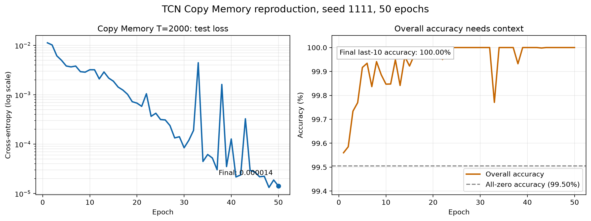
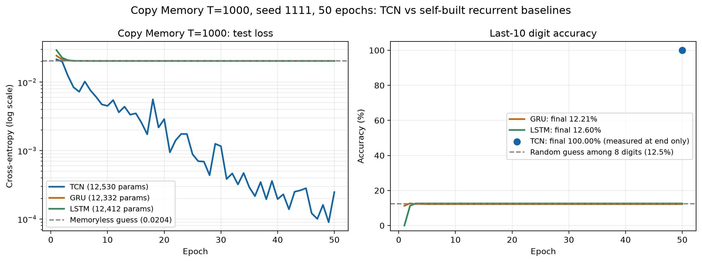
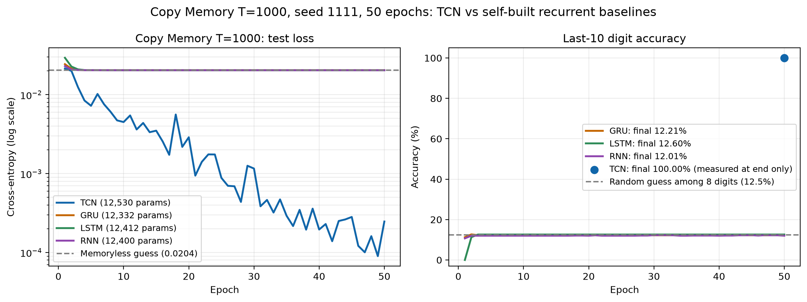

# TCN Reproduction: Adding Problem · Copy Memory

[](https://colab.research.google.com/github/chamelewan/tcn-reproduction/blob/main/notebooks/TCN_01_Adding_Problem.ipynb)

Google Colab에서 **locuslab/TCN의 Adding Problem과 Copy Memory**를 실행하고 로그와 결과를 정리한 재현 기록입니다. 2026-11-10의 T=200·400 초기 실행과 2026-11-24의 T=600 및 순환신경망 기준 모델 실험, Copy Memory T=1000 실험을 포함합니다. 원 논문 전체 벤치마크 또는 O-RAN 트래픽 예측을 재현한 저장소는 아닙니다.

## 원본 연구

- Bai, Kolter, Koltun (2018), *An Empirical Evaluation of Generic Convolutional and Recurrent Networks for Sequence Modeling*
- [논문](https://arxiv.org/abs/1803.01271) · [원본 저장소](https://github.com/locuslab/TCN)
- 사용 커밋: `2f8c2b817050206397458dfd1f5a25ce8a32fe65`
- 원본 코드는 MIT 라이선스이며 [원본 LICENSE](https://github.com/locuslab/TCN/blob/2f8c2b817050206397458dfd1f5a25ce8a32fe65/LICENSE)를 따릅니다. 원본 모델·학습 소스를 복사하지 않고 노트북에서 해당 커밋을 내려받습니다.

## 실행 방법

1. 위 **Open in Colab** 버튼으로 노트북을 엽니다. 수정하려면 본인 Drive에 사본을 저장합니다.
2. **런타임 → 런타임 유형 변경 → NVIDIA GPU**를 선택합니다. 기록된 실행 장치는 L4입니다.
3. `TCN_01_Adding_Problem.ipynb`의 코드 셀을 위에서 아래로 실행합니다. 맥에서는 셀 왼쪽 ▶ 또는 **Shift + Return**을 사용합니다.
4. 환경 확인 → 원본 커밋 체크아웃 → GPU 순전파 → T=200 학습 → T=400 학습 → 로그 ZIP → 비교 그래프 순서입니다.
5. 로그·그래프는 `/content/TCN/reproduction_logs/`에 생성됩니다. 임시 파일이므로 다운로드 셀로 보관합니다.

필요한 Python 패키지는 PyTorch, NumPy, Matplotlib입니다. 기록된 Colab 환경에서는 별도 설치 없이 사용했습니다. 현재 런타임의 버전은 환경 확인 셀에서 확인하세요. 버전 차이에 따른 완전한 수치 일치는 보장하지 않습니다.

## 실험 환경과 조건

실행일: 2026-11-10. Python **3.13.16**, PyTorch **2.14.1+cu130**, GPU **NVIDIA L4**. NumPy·Matplotlib의 실행 당시 버전은 기록하지 않았습니다.

공통 설정: 학습 50,000개 / 테스트 1,000개, 배치 32, 커널 7, 블록당 채널 30, dropout 0, Adam, 학습률 0.004, 3에폭. PyTorch·NumPy 시드 모두 1111입니다. 원본 학습 파일은 수정하지 않고 실행 래퍼에서 NumPy 시드를 추가했습니다. GPU 결정적 연산 모드를 별도로 강제하지 않았습니다.

Adding Problem은 난수 채널과 두 위치를 표시하는 마커 채널을 입력받아, 표시된 두 난수의 합을 예측하는 인공 과제입니다.

## 결과

| 조건 | 블록 수 | 수용 영역 | Epoch 1 Test MSE | Epoch 2 Test MSE | Epoch 3 Test MSE (최종) | 전체 실행 시간 |
| --- | ---: | ---: | ---: | ---: | ---: | --- |
| T=200 | 7 | 1,525 | 0.001812 | 0.000285 | **0.000531** | 미측정 |
| T=400 | 8 | 3,061 | 0.166145 | 0.001375 | **0.002161** | 62.5초 |

두 프로세스 모두 종료 코드 0으로 정상 종료됐습니다. T=400 시간은 데이터 생성·모델 구성·학습·평가 등을 포함한 전체 프로세스 경과 시간입니다.


- 왼쪽은 로그의 학습 구간 손실입니다. 가로축은 실제 시간이 아닌 에폭 진행량입니다.
- 오른쪽은 에폭 종료 시 측정한 테스트 값 3개입니다. 연결선 중간을 평가한 것은 아닙니다.
- 두 세로축은 로그 눈금입니다. T=200은 1에폭 후반, T=400은 2에폭 중반에 급격한 오차 감소를 보였습니다.
- 두 조건 모두 2에폭의 Test MSE가 최저이고 3에폭에는 상승했습니다. 단일 실행만으로 과적합을 확정하지 않습니다.

## 재현 범위와 한계

- 길이와 블록 수가 함께 바뀌어 **길이만의 효과를 분리한 실험이 아닙니다.** 단일 실행이며 평균·표준편차는 없습니다.
- 원본은 같은 테스트셋을 매 에폭 평가합니다. 최종값과 최저 관측값을 구분하며 별도 검증셋으로 최적 에폭을 선택한 실험은 아닙니다.
- 학습 가중치·최적 체크포인트는 저장하지 않았습니다. 로그와 그래프만 포함합니다.
- `weight_norm` FutureWarning이 발생했으나 실행은 완료됐습니다. 원본 API를 유지했습니다.
- 저장된 출력은 실제 Colab 실행에서 얻었습니다. 게시용으로 커밋 고정, 생성된 로그 경로 자동 전달, 학습 프로세스 오류 검사와 설명을 추가하고 다운로드 UI 임시 출력을 제거했습니다. 학습 설정과 기존 수치는 유지했습니다.
- **게시용 정리 후 전체 GPU 학습은 다시 실행하지 않았습니다.** Python 셀 구문 검사와 저장 로그 평가값 확인을 수행했습니다. 기존 수치를 새 코드 실행 결과로 주장하지 않습니다.

## 파일 구성

```text
notebooks/TCN_01_Adding_Problem.ipynb  # 실행 셀과 저장된 과거 결과
logs/                               # 두 실행의 텍스트 로그
results/adding_T200_T400_comparison.png
```

현재 결과를 출발점으로 논문 설정 대조, 추가 길이 조건, 반복 실행 등을 이어갈 예정입니다.

## 2026-11-24: T=600 및 기준 모델 비교

추가 실험은 NVIDIA T4에서 진행했습니다. 원본 TCN 커밋은 위와 같으며, T=600 모델은 논문 부록의 커널 8·블록 8·채널 24 설정을 사용했습니다. 모델 파라미터는 70,369개입니다. 학습 50,000개·테스트 1,000개, 배치 32, Adam 학습률 0.004, dropout 0, 손실 함수 MSE입니다. NumPy와 PyTorch에 동일한 시드를 설정했습니다. 원본 TCN 스크립트의 `--cuda` 옵션은 역으로 CPU를 선택하므로 GPU 실행 시 전달하지 않습니다.

GRU·LSTM·RNN은 **논문 저자의 공개 구현이 아닌 직접 구성한 단일 계층 기준 모델**입니다. 원본 `data_generator`를 사용했고, 모델 크기를 약 7만 파라미터로 맞췄습니다. 같은 시드의 모델은 동일한 난수 생성 순서로 만든 학습·테스트 데이터를 사용하도록 했습니다. GPU 결정적 연산 모드는 강제하지 않았으므로 같은 시드로 재실행해도 결과가 정확히 일치하지 않을 수 있습니다.

| 시드 | 모델 | 파라미터 | 3에폭 테스트 MSE | 10에폭 테스트 MSE |
| --- | --- | ---: | ---: | ---: |
| 1111 | TCN | 70,369 | 0.000671 | 0.000659 |
| 1111 | GRU | 69,451 | 0.000115 | 0.000027 |
| 1111 | LSTM | 69,811 | 0.181890 | 0.000403 |
| 1111 | RNN | 69,955 | 0.182912 | 0.189242 |
| 2222 | TCN | 70,369 | 0.175058 | 0.000102 |
| 2222 | GRU | 69,451 | 0.000150 | 0.000026 |

표의 TCN 3에폭 값은 **각 10에폭 실행의 세 번째 평가값**입니다. 별도로 수행한 3에폭 실행의 최종값은 시드 1111에서 0.001388, 시드 2222에서 0.175206이었습니다. 최종값과 실행 중 최저값을 구분합니다. 예를 들어 시드 1111의 TCN은 9에폭 0.000158이었으나 10에폭 최종값은 0.000659입니다. 별도 검증셋으로 에폭을 선택하지 않았고 같은 테스트셋을 매 에폭 평가했습니다.

시드 1111의 LSTM은 8에폭, 시드 2222의 TCN은 7에폭부터 오차가 크게 감소했습니다. RNN은 10에폭 후에도 거의 일정한 값만 예측했습니다. 두 시드의 TCN·GRU 비교에서 GRU가 더 낮은 최종 오차를 냈습니다. 이 결과는 이 합성 과제·직접 구성한 기준 모델·제한된 시드와 학습 설정에만 해당합니다. 논문의 순환신경망 결과나 O-RAN 트래픽 예측의 재현으로 해석하지 않습니다.


`notebooks/TCN_20261124_session_archive.ipynb`는 **실제 Colab 세션에서 내려받은 실행 기록**입니다. 11월 10일 셀과 11월 24일 셀이 이어 붙어 있으며, 중간에 같은 저장소를 다시 복제하는 셀이 있으므로 처음부터 **모두 실행**하지 마세요. 저장된 출력은 실제 실행 결과지만, GitHub에 올린 뒤 다시 GPU로 전체 실행하지는 않았습니다.

순환신경망 기준 모델을 새 런타임에서 실행할 때는 원본 저장소를 해당 커밋으로 복제한 뒤 이 저장소의 스크립트를 사용합니다. 이 스크립트는 세션의 학습 코드를 정리한 것이며 게시 후 GPU 재실행은 아직 하지 않았습니다.

```bash
git clone https://github.com/locuslab/TCN.git /content/TCN
git -C /content/TCN checkout 2f8c2b817050206397458dfd1f5a25ce8a32fe65
git clone https://github.com/chamelewan/tcn-reproduction.git /content/tcn-reproduction
python /content/tcn-reproduction/scripts/run_t600_recurrent.py --repo /content/TCN --model GRU --seed 1111 --epochs 10
```

`--model`은 `GRU`, `LSTM`, `RNN` 중 하나입니다. 시드 2222 GRU 실행은 `--seed 2222`를 사용합니다. 원본 TCN 실행 코드는 세션 기록 노트북에 있습니다. `logs/`에는 T=600 TCN의 원본 출력, `results/`에는 순환신경망의 에폭별 JSON과 비교 CSV·PNG를 보관합니다. 학습 가중치 체크포인트는 사용자의 별도 로컬 ZIP 백업에 있으며 이 공개 저장소에는 넣지 않았습니다.

## 2026-11-24: Copy Memory T=1000

[](https://colab.research.google.com/github/chamelewan/tcn-reproduction/blob/main/notebooks/TCN_02_Copy_Memory.ipynb)

Copy Memory는 입력 앞쪽의 숫자 10개를 기억했다가 길이 T의 빈 구간 뒤에 그대로 다시 출력하는 합성 과제입니다. T=1000이면 전체 길이는 1,020이고, 정답 1,020칸 중 1,010칸이 0입니다. 따라서 **전부 0만 예측해도 전체 정확도는 약 99.02%**이므로 마지막 10칸 정확도를 따로 계산했습니다.

실행 장치는 NVIDIA Tesla T4입니다. 원본 `TCN.copy_memory.copymem_test`를 수정하지 않고 `runpy` 래퍼로 실행했으며, 래퍼에서 NumPy 시드를 추가했습니다. 설정: 시드 1111, 커널 8, 블록 8, 채널 10, dropout 0.05, RMSprop 학습률 0.0005, 배치 32(원본 기본값). GPU 결정적 연산 모드는 강제하지 않았습니다.

| 실행 | 파라미터 | 최종 전체 테스트 손실 | 실행 중 최저 손실 | 최종 전체 정확도 | 최종 마지막 10칸 정확도 | 전체 실행 시간 |
| --- | ---: | ---: | ---: | ---: | ---: | --- |
| T=1000, 10에폭 예비 실행 | 12,530 | 0.00439484 | 0.00439484 (10에폭) | 99.9247% | 미측정 | 48.0초 |
| T=1000, 50에폭 (처음부터) | 12,530 | **0.00024682** | 0.00008991 (49에폭) | 100.0000% | **100.0000%** | 188.6초 |
| T=2000, 50에폭 (처음부터) | 12,530 | **0.00001421** | 0.00001328 (48에폭) | 100.0000% | **100.0000%** | 243.3초 |

- 50에폭 실행은 10에폭 실행을 이어 학습한 것이 아니라 **처음부터 다시 실행**했습니다. 원본 코드가 체크포인트를 저장하지 않기 때문입니다.
- 마지막 10칸만의 cross-entropy는 0.02515841입니다. 정답 숫자를 모두 맞혀도 확률이 정확히 1은 아니므로 정확도 100%와 양립합니다.
- 테스트 손실은 에폭마다 흔들렸습니다. 최종값(50에폭)과 실행 중 최저값(49에폭)을 구분하며, 별도 검증셋으로 에폭을 선택하지 않았습니다.
- 원 논문 Table 1의 Copy Memory T=1000 TCN 손실은 3.5e-5입니다. 이번 최종 손실은 그보다 높습니다. 논문 Table 1은 모델 크기를 약 16K로 기재하고 원본 코드 기본값 모델은 12,530개여서 조건이 완전히 같지 않습니다.
- 원본 `copymem_test.py`의 학습 루프는 `clip_grad_norm_`을 `loss.backward()`보다 **먼저** 호출합니다(119–121행). 따라서 로그의 `clip=1.0`만으로 그래디언트 클리핑이 실제로 적용됐다고 보지 않습니다. 코드는 원본 그대로 실행했습니다.
- 단일 시드·단일 실행입니다. 순환신경망 기준 모델 비교는 아래 "GRU·LSTM 기준 모델" 섹션에 있습니다.



그래프는 50에폭 로그에서 `scripts/plot_copy_memory.py`로 생성했습니다. 왼쪽은 전체 테스트 손실(로그 눈금), 오른쪽은 전체 정확도와 '전부 0 예측' 기준선(99.02%)입니다.

```bash
python scripts/plot_copy_memory.py logs/copy_memory_T1000_seed1111_50epochs_20261124_051148.log results/copy_memory_T1000_seed1111_50epochs.png
```

`notebooks/TCN_02_Copy_Memory.ipynb`는 실제 Colab 세션에서 내려받은 실행 기록입니다. 게시 시 파일 다운로드 UI의 임시 출력만 제거했고 코드와 학습 출력은 그대로입니다. T=1000 노트북 출력의 평가값 60개(10에폭 10개, 50에폭 50개)는 `logs/`의 두 로그와 일치함을 확인했습니다. 게시 후 GPU 재실행은 하지 않았습니다. 50에폭 체크포인트는 사용자의 로컬 ZIP 백업에만 있고 이 저장소에는 넣지 않았습니다.

### T=2000 추가 실행

T=1000과 같은 모델·학습 설정(시드 1111, 50에폭, 파라미터 12,530개)에서 빈 구간만 2000으로 늘렸습니다. 전체 길이는 2,020이며, 전부 0 예측의 전체 정확도는 약 99.50%입니다. 이 모델의 수용 영역(receptive field)은 1 + 2×(8−1)×(2⁸−1) = 3,571칸으로 전체 길이보다 깁니다.

- 최종 마지막 10칸 정확도는 **100.0000%**, 마지막 10칸 cross-entropy는 0.00284679입니다.
- 최종 전체 테스트 손실은 0.00001421(50에폭), 실행 중 최저는 0.00001328(48에폭)입니다.
- 전체 정확도는 19에폭에 처음 100%가 된 뒤에도 33에폭(99.7709%), 38에폭(99.9323%) 등에서 일시적으로 떨어졌습니다. 손실도 33·38·43에폭에 튀었습니다.
- T=2000의 최종 손실이 T=1000보다 낮지만 **단일 시드 결과**이므로 "길수록 쉽다"고 해석하지 않습니다. T=1000은 50에폭 시점에 손실이 튄 상태였고, 길이에 따라 손실을 평균하는 칸 수(0이 정답인 칸의 비율)도 다릅니다.
- 원 논문 Table 1은 Copy Memory를 T=1000으로만 보고하므로 T=2000은 논문 수치와 직접 비교하지 않습니다.



T=2000 실행 셀은 `notebooks/TCN_02_Copy_Memory.ipynb`의 마지막 셀입니다. 같은 Colab 세션에서 다시 내려받은 노트북으로 교체했으며, 이 셀 출력의 평가값 50개와 최종 지표가 로그와 일치함을 확인했습니다. 실행 근거는 `logs/copy_memory_T2000_seed1111_50epochs_20261124_052742.log`이며, 로그·체크포인트 ZIP의 무결성 검사를 통과했습니다. `scripts/plot_copy_memory.py`는 로그의 `blank_len`에서 T와 전부 0 기준선을 계산하도록 수정했고, 수정 후 T=1000 그래프를 다시 그려 기존 그래프와 같음을 확인했습니다.

### T=1000 GRU·LSTM 기준 모델

TCN과 같은 데이터(원본 `data_generator`, NumPy 시드 1111, 학습 10,000개 → 테스트 1,000개 순서로 생성)에서 **직접 구성한 단일 계층 GRU·LSTM**을 학습했습니다. 입력은 TCN과 같이 한 칸당 숫자 하나이며, 파라미터를 TCN(12,530개)과 비슷하게 맞췄습니다. RMSprop 학습률 0.0005, 배치 32, 셔플 없음, 50에폭, 전체 1,020칸 cross-entropy로 TCN 원본 기본값과 같습니다.

| 모델 | 은닉 크기 | 파라미터 | 50에폭 전체 테스트 손실 | 전체 정확도 | 마지막 10칸 정확도 | 마지막 10칸 cross-entropy | 학습 시간 |
| --- | ---: | ---: | ---: | ---: | ---: | ---: | --- |
| TCN (원본 코드) | 채널 10 × 8블록 | 12,530 | 0.00024682 | 100.0000% | **100.0000%** | 0.02515841 | 188.6초(전체 프로세스) |
| GRU (직접 구성) | 61 | 12,332 | 0.02042199 | 99.1393% | **12.2100%** | 2.08304358 | 68.9초 |
| LSTM (직접 구성) | 53 | 12,412 | 0.02039644 | 99.1431% | **12.6000%** | 2.08043671 | 55.6초 |

- 앞 10개 숫자는 1~8 중 하나이므로 기억 없이 찍으면 마지막 10칸 정확도는 12.5%, cross-entropy는 ln 8 ≈ 2.0794입니다. 이때 전체 1,020칸 평균 손실은 10·ln 8 / 1020 ≈ **0.020387**입니다(이 식은 우리가 계산한 값이며 논문에 적힌 식은 아닙니다). GRU·LSTM은 3~5에폭 이후 이 값에 머물렀습니다. 즉 **50에폭 동안 앞의 숫자를 기억하지 못했습니다.**
- 원 논문 Table 1의 Copy Memory T=1000 손실은 LSTM 0.0204, GRU 0.0197, RNN 0.0202, TCN 3.5e-5입니다(모델 크기 약 16K). 논문 5.2절도 LSTM·GRU가 기억 없는 수준의 손실로 수렴한다고 기술합니다. 우리의 GRU·LSTM 손실도 같은 수준이며 **경향은 논문과 일치**합니다. 다만 설정이 같지 않으므로 수치 일치를 주장하지 않습니다.
- **TCN 실행과 다른 점:** 순환신경망에는 그래디언트 클리핑 1.0을 `backward()` 뒤에 정상 적용했습니다(TCN 원본은 호출 순서 때문에 실제 적용되지 않음). 순환신경망에 유리한 차이입니다.
- **한계:** 논문은 순환신경망의 옵티마이저·학습률·클리핑·드롭아웃·forget gate bias를 격자 탐색(grid search)했지만, 우리는 TCN 기본값 한 가지 설정만 사용했습니다. 단일 시드이며, 다른 학습률·초기화·더 긴 학습에서 순환신경망이 학습될 가능성을 배제하지 않습니다.
- TCN의 마지막 10칸 정확도는 50에폭 종료 후에만 측정했으므로 그래프에 점 하나로 표시했습니다. GRU·LSTM은 매 에폭 측정했습니다.
- 논문 5.4절은 모델 크기를 약 10K라고 쓰고 Table 1은 약 16K로 기재해, 논문 안에서도 크기 표기가 다릅니다. 논문 Figure 4는 T=500·1000을 보여 주며, T=500 결과는 아래 섹션에 있습니다.



실행 스크립트는 `scripts/run_copy_memory_recurrent.py`(Colab에서 실제 실행한 파일과 동일), 로그는 `logs/copy_memory_T1000_{gru,lstm}_seed1111_50epochs_20261124_053815.log`, 에폭별 수치는 `results/*_results.json`입니다. 로그와 JSON의 에폭별 손실이 일치함을 확인했고, ZIP 무결성 검사를 통과했습니다. 체크포인트는 로컬 ZIP에만 보관합니다. 이 실행 셀은 `notebooks/TCN_02_Copy_Memory.ipynb`의 7번째 셀이며, 셀 안에서 만든 스크립트가 저장소의 `scripts/run_copy_memory_recurrent.py`와 같음을 확인했습니다.

```bash
python /content/tcn-reproduction/scripts/run_copy_memory_recurrent.py --repo /content/TCN --model GRU --hidden 61 --out_prefix /content/copy_memory_T1000_gru
python scripts/plot_copy_memory_baselines.py --tcn-log logs/copy_memory_T1000_seed1111_50epochs_20261124_051148.log --baseline GRU results/copy_memory_T1000_gru_seed1111_50epochs_20261124_053815_results.json --baseline LSTM results/copy_memory_T1000_lstm_seed1111_50epochs_20261124_053815_results.json results/copy_memory_T1000_tcn_gru_lstm_comparison_20261124.png
```

### T=500: TCN(논문 부록 설정)·GRU·LSTM

TCN은 **논문 부록 Table 2의 T=500 설정**(커널 6, 블록 9, 채널 10, dropout 0.05, RMSprop 5e-4)으로 원본 코드를 실행했습니다. 파라미터는 10,750개이고 수용 영역은 1 + 2×5×(2⁹−1) = 5,111칸입니다. T=1000·2000의 TCN(커널 8, 블록 8)과 모델 구조가 다릅니다. GRU·LSTM은 T=1000과 같은 직접 구성 모델·설정에서 길이만 500으로 바꿨습니다(`scripts/run_copy_memory_recurrent.py --blank_len 500`, 저장소 커밋 `a141aea`에서 실행). 전체 길이는 520이며, 전부 0 예측 정확도는 약 98.08%, 기억 없는 찍기의 전체 손실은 10·ln 8 / 520 ≈ 0.039989입니다.

| 모델 | 파라미터 | 50에폭 전체 테스트 손실 | 실행 중 최저 손실 | 전체 정확도 | 마지막 10칸 정확도 | 마지막 10칸 cross-entropy | 실행 시간 |
| --- | ---: | ---: | ---: | ---: | ---: | ---: | --- |
| TCN (k6·l9) | 10,750 | 0.00013040 | 0.00007909 (46에폭) | 100.0000% | **100.0000%** | 0.00676596 | 191.1초(전체 프로세스) |
| GRU (직접 구성) | 12,332 | 0.03950760 | 0.03950760 (50에폭) | 98.3675% | **15.1100%** | 2.05433607 | 39.8초(학습) |
| LSTM (직접 구성) | 12,412 | 0.04001097 | 0.04001097 (50에폭) | 98.3192% | **12.6000%** | 2.08057022 | 41.9초(학습) |

- TCN은 23에폭에 전체 정확도 100%에 처음 도달했고, 이후 27에폭(99.8231%) 등에서 일시적으로 떨어졌다가 50에폭에 마지막 10칸을 모두 맞혔습니다.
- LSTM은 50에폭 내내 기억 없는 찍기 수준(마지막 10칸 12.6%)에 머물렀습니다.
- GRU는 48에폭까지 찍기 수준(12.21%)이었고, **49·50에폭에 마지막 10칸 정확도가 15.22%·15.11%로 약간 올랐습니다.** 학습이 시작되는 신호일 수도 있지만 50에폭에서 끝났으므로 이후 추세는 알 수 없습니다. 더 길게 학습했을 때 GRU가 이 과제를 풀지 여부는 실행하지 않았으므로 판단하지 않습니다.
- 논문 5.4절은 같은 크기의 LSTM·GRU가 T가 커질수록 무작위 추측으로 수렴한다고 서술합니다. 이번 T=500·1000 결과는 그 경향과 맞지만, 순환신경망의 하이퍼파라미터 탐색 없이 한 가지 설정·단일 시드로 얻은 결과입니다.


TCN 단독 학습 곡선은 `results/copy_memory_T500_tcn_k6_l9_seed1111_50epochs.png`에 있습니다. 실행 셀은 노트북의 8번째 셀입니다. 노트북 출력의 평가값 150개가 세 로그와 일치하고, ZIP 무결성 검사를 통과했으며, GRU·LSTM 로그와 JSON의 에폭별 손실이 일치함을 확인했습니다. 체크포인트는 로컬 ZIP에만 보관합니다. `scripts/plot_copy_memory_baselines.py`의 제목이 로그의 T·시드를 읽도록 수정했고, T=1000 비교 그래프를 다시 그려 기존 파일과 같음을 확인했습니다.

### 기본 RNN 기준 모델 (T=500·1000)

논문 Table 1의 Copy Memory 행에 있는 세 번째 순환신경망 기준 모델입니다. GRU·LSTM과 같은 스크립트·데이터·학습 설정(RMSprop 5e-4, 배치 32, 50에폭, 클리핑 1.0을 `backward()` 뒤 적용)을 사용했고, 은닉 크기 105의 단일 계층 `nn.RNN`(tanh)으로 파라미터 12,400개입니다. 저장소 커밋 `cdeeb7f`의 스크립트로 실행했습니다(노트북 9번째 셀).

| T | 파라미터 | 50에폭 전체 테스트 손실 | 기억 없는 찍기 손실 | 전체 정확도 | 마지막 10칸 정확도 | 마지막 10칸 cross-entropy | 학습 시간 |
| --- | ---: | ---: | ---: | ---: | ---: | ---: | --- |
| 500 | 12,400 | 0.04008322 | 0.03998926 | 98.3117% | **12.2100%** | 2.08432627 | 37.4초 |
| 1000 | 12,400 | 0.02043562 | 0.02038668 | 99.1374% | **12.0100%** | 2.08443260 | 53.2초 |

- 두 길이 모두 50에폭 동안 마지막 10칸 정확도가 10.69~12.28% 사이에 머물렀고, 손실은 기억 없는 찍기 수준과 거의 같았습니다. GRU·LSTM과 같은 양상입니다. 원 논문 Table 1의 RNN T=1000 손실은 0.0202입니다.
- 한계는 GRU·LSTM과 같습니다(하이퍼파라미터 탐색 없음, 단일 시드, TCN과 클리핑 적용 방식이 다름).

**Copy Memory 마지막 10칸 정확도 요약** (시드 1111, 50에폭, 모두 실제 실행값)

| T | TCN | GRU | LSTM | RNN |
| --- | ---: | ---: | ---: | ---: |
| 500 | 100.00% (논문 설정 k6·l9) | 15.11% | 12.60% | 12.21% |
| 1000 | 100.00% | 12.21% | 12.60% | 12.01% |
| 2000 | 100.00% | 실행 안 함 | 실행 안 함 | 실행 안 함 |



T=500 네 모델 비교 그래프는 `results/copy_memory_T500_tcn_rnn_gru_lstm_comparison_20261124.png`입니다. RNN 없이 그린 기존 비교 그래프는 그대로 보존했습니다. 노트북 출력의 평가값 100개가 RNN 로그 2개와 일치하고, 로그와 JSON의 에폭별 손실이 일치하며, ZIP 무결성 검사를 통과했습니다. 체크포인트는 로컬 ZIP에만 보관합니다.

### T=1000 다중 시드 (1111·2222·3333)

시드 1111 결과가 우연인지 확인하기 위해, 같은 모델·설정에서 시드만 2222·3333으로 바꿔 네 모델을 다시 학습했습니다(노트북 10번째 셀, 저장소 커밋 `cf4e9f2`의 스크립트). 시드는 TCN·순환신경망 모두 NumPy와 PyTorch에 같은 값을 주었으므로, 시드가 바뀌면 학습·테스트 데이터도 새로 생성됩니다.

| 모델 | 지표 (50에폭 최종) | 시드 1111 | 시드 2222 | 시드 3333 |
| --- | --- | ---: | ---: | ---: |
| TCN | 마지막 10칸 정확도 | 100.00% | 100.00% | 100.00% |
| TCN | 테스트 손실 | 0.00024682 | 0.00013439 | 0.00005611 |
| GRU | 마지막 10칸 정확도 | 12.21% | **19.72%** | **21.65%** |
| GRU | 테스트 손실 | 0.02042199 | 0.01932144 | 0.01837932 |
| LSTM | 마지막 10칸 정확도 | 12.60% | 12.64% | 12.68% |
| LSTM | 테스트 손실 | 0.02039644 | 0.02038703 | 0.02039414 |
| RNN | 마지막 10칸 정확도 | 12.01% | 12.54% | 12.60% |
| RNN | 테스트 손실 | 0.02043562 | 0.02041769 | 0.02042366 |

- TCN은 세 시드 모두 50에폭 후 마지막 10칸 100%였습니다. 전체 정확도가 처음 100%에 도달한 에폭은 시드 2222에서 36, 3333에서 35입니다. 시드 3333의 최종 손실 5.6e-5는 논문 3.5e-5와 같은 자릿수입니다.
- LSTM·RNN은 세 시드 모두 기억 없는 찍기 수준(손실 ≈ 0.020387, 정확도 ≈ 12.5%)이었습니다.
- **GRU는 시드 2222·3333에서 찍기 수준을 벗어났습니다.** 마지막 10칸 정확도가 처음 14%를 넘은 에폭은 각각 29·16이고, 50에폭에 19.72%·21.65%, 손실은 기억 없는 찍기 손실(0.020387)보다 낮았습니다. 일부 정보를 기억하기 시작한 것으로 보이며, 더 길게 학습했을 때의 결과는 실행하지 않았으므로 판단하지 않습니다.
- 결과 해석: "TCN은 50에폭 안에 세 시드 모두 해결, 같은 조건의 순환신경망은 해결하지 못함(GRU만 부분적 진전)"입니다. 순환신경망 하이퍼파라미터 탐색이 없다는 한계는 그대로입니다.

노트북 출력의 평가값 400개가 로그 8개와 일치하고, 순환신경망 로그와 JSON의 에폭별 손실이 일치하며, ZIP 무결성 검사를 통과했습니다. 체크포인트는 로컬 ZIP에만 보관합니다.

## 2026-11-24: 가설 검증 — Adding T=600에서 GRU의 우위는 TCN 학습률 때문인가

**관찰:** Adding T=600에서 직접 구성한 GRU(10에폭 MSE 약 2.7e-5)가 TCN(6.59e-4 / 1.02e-4)보다 낮은 오차를 냈고, TCN 오차는 에폭마다 흔들렸습니다. TCN 학습률은 원본 코드 기본값 0.004였는데, 논문 5절은 TCN에 기본적으로 Adam 0.002를 썼다고 서술합니다("unless otherwise noted").

**가설 H1:** GRU의 우위는 구조 차이가 아니라 TCN 학습률(0.004)이 커서 학습이 불안정했기 때문이다.

**실험:** TCN 학습률만 0.002·0.001로 바꾸고 나머지(k8·L8·채널 24, Adam, 배치 32, 10에폭, 클리핑 없음)는 기존과 같게, 시드 1111·2222로 실행했습니다. 원본 `add_test.py`를 수정 없이 `runpy`로 실행했습니다(노트북 11번째 셀).

**미리 정한 판정 기준:** 두 시드 모두 GRU 수준(약 3e-5)에 근접 → 지지 / 두 시드 모두 1e-4 이상 → 기각 / 시드마다 다름 → 보류.

| TCN 학습률 | 시드 1111 최종 (최저, 에폭) | 시드 2222 최종 (최저, 에폭) | 테스트 MSE가 처음 0.01 아래로 간 에폭 (1111 / 2222) |
| --- | ---: | ---: | --- |
| 0.004 (기존) | 0.000659 (0.000158, 9) | 0.000102 (0.000102, 10) | 2 / 7 |
| 0.002 | 0.000706 (0.000361, 5) | 0.000211 (0.000211, 10) | 2 / 4 |
| 0.001 | 0.000250 (0.000206, 9) | 0.000288 (0.000288, 10) | 2 / 7 |
| GRU 0.004 (참고) | 0.000027 | 0.000026 | — |

**판정: H1 기각 (10에폭 기준).** 학습률을 낮춘 네 실행 모두 최종 MSE가 1e-4 이상(2.1e-4~7.1e-4)으로 GRU 수준에 미치지 못했고, 기존 0.004보다 일관되게 낫지도 않았습니다. 시드 2222의 늦은 학습 시작도 학습률 0.001에서 그대로 7에폭이었습니다.

**해석 시 주의:** 학습률이 낮으면 수렴이 느릴 수 있습니다. 네 실행 중 세 실행은 최저값이 10에폭(또는 9에폭)에 나와 아직 내려가는 중이었으므로, "같은 10에폭 예산에서는 학습률만으로 GRU와의 차이를 설명하지 못한다"까지만 주장합니다. 더 긴 학습, GRU 쪽 학습률 조정, 구조 가설(게이트가 표시된 값을 저장하는 동작) 검증은 하지 않았습니다. 각 실행은 약 180초였고, 로그는 `logs/adding_T600_tcn_lr*_seed*_10epochs_20261124_072218.log`입니다. 노트북 출력의 평가값 40개가 로그와 일치하고 ZIP 무결성 검사를 통과했습니다.
