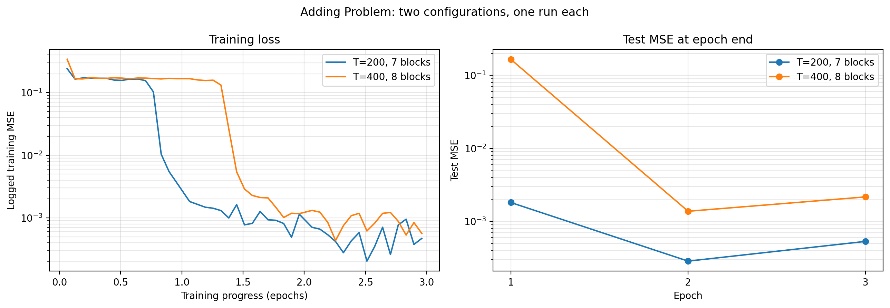

# TCN Adding Problem Reproduction

[](https://colab.research.google.com/github/chamelewan/tcn-reproduction/blob/main/notebooks/TCN_01_Adding_Problem.ipynb)

Google Colab에서 **locuslab/TCN의 Adding Problem 두 조건**을 실행하고 로그와 결과를 정리한 재현 기록입니다. 각 조건은 단일 시드로 한 번 실행했습니다. 원 논문 전체 벤치마크 또는 O-RAN 트래픽 예측을 재현한 저장소는 아닙니다.

## 원본 연구

- Bai, Kolter, Koltun (2018), *An Empirical Evaluation of Generic Convolutional and Recurrent Networks for Sequence Modeling*
- [논문](https://arxiv.org/abs/1803.01271) · [원본 저장소](https://github.com/locuslab/TCN)
- 사용 커밋: `2f8c2b817050206397458dfd1f5a25ce8a32fe65`
- 원본 코드는 MIT 라이선스이며 [원본 LICENSE](https://github.com/locuslab/TCN/blob/2f8c2b817050206397458dfd1f5a25ce8a32fe65/LICENSE)를 따릅니다. 원본 모델·학습 소스를 복사하지 않고 노트북에서 해당 커밋을 내려받습니다.

## 실행 방법

1. 위 **Open in Colab** 버튼으로 노트북을 엽니다. 수정하려면 본인 Drive에 사본을 저장합니다.
2. **런타임 → 런타임 유형 변경 → NVIDIA GPU**를 선택합니다. 기록된 실행 장치는 L4입니다.
3. 코드 셀을 위에서 아래로 실행합니다. 맥에서는 셀 왼쪽 ▶ 또는 **Shift + Return**을 사용합니다.
4. 환경 확인 → 원본 커밋 체크아웃 → GPU 순전파 → T=200 학습 → T=400 학습 → 로그 ZIP → 비교 그래프 순서입니다.
5. 로그·그래프는 `/content/TCN/reproduction_logs/`에 생성됩니다. 임시 파일이므로 다운로드 셀로 보관합니다.

필요한 Python 패키지는 PyTorch, NumPy, Matplotlib입니다. 기록된 Colab 환경에서는 별도 설치 없이 사용했습니다. 현재 런타임의 버전은 환경 확인 셀에서 확인하세요. 버전 차이에 따른 완전한 수치 일치는 보장하지 않습니다.

## 실험 환경과 조건

실행일: 2026-11-10. Python **3.13.16**, PyTorch **2.14.1+cu130**, GPU **NVIDIA L4**. NumPy·Matplotlib의 실행 당시 버전은 기록하지 않았습니다.

공통 설정: 학습 50,000개 / 테스트 1,000개, 배치 32, 커널 7, 블록당 채널 30, dropout 0, Adam, 학습률 0.004, 3에폭. PyTorch·NumPy 시드 모두 1111입니다. 원본 학습 파일은 수정하지 않고 실행 래퍼에서 NumPy 시드를 추가했습니다. GPU 결정적 연산 모드를 별도로 강제하지 않았습니다.

Adding Problem은 난수 채널과 두 위치를 표시하는 마커 채널을 입력받아, 표시된 두 난수의 합을 예측하는 인공 과제입니다.

## 결과

| 조건 | 블록 수 | 수용 영역 | Epoch 1 Test MSE | Epoch 2 Test MSE | Epoch 3 Test MSE (최종) | 전체 실행 시간 |
| --- | ---: | ---: | ---: | ---: | ---: | --- |
| T=200 | 7 | 1,525 | 0.001812 | 0.000285 | **0.000531** | 미측정 |
| T=400 | 8 | 3,061 | 0.166145 | 0.001375 | **0.002161** | 62.5초 |

두 프로세스 모두 종료 코드 0으로 정상 종료됐습니다. T=400 시간은 데이터 생성·모델 구성·학습·평가 등을 포함한 전체 프로세스 경과 시간입니다.



- 왼쪽은 로그의 학습 구간 손실입니다. 가로축은 실제 시간이 아닌 에폭 진행량입니다.
- 오른쪽은 에폭 종료 시 측정한 테스트 값 3개입니다. 연결선 중간을 평가한 것은 아닙니다.
- 두 세로축은 로그 눈금입니다. T=200은 1에폭 후반, T=400은 2에폭 중반에 급격한 오차 감소를 보였습니다.
- 두 조건 모두 2에폭의 Test MSE가 최저이고 3에폭에는 상승했습니다. 단일 실행만으로 과적합을 확정하지 않습니다.

## 재현 범위와 한계

- 길이와 블록 수가 함께 바뀌어 **길이만의 효과를 분리한 실험이 아닙니다.** 단일 실행이며 평균·표준편차는 없습니다.
- 원본은 같은 테스트셋을 매 에폭 평가합니다. 최종값과 최저 관측값을 구분하며 별도 검증셋으로 최적 에폭을 선택한 실험은 아닙니다.
- 학습 가중치·최적 체크포인트는 저장하지 않았습니다. 로그와 그래프만 포함합니다.
- `weight_norm` FutureWarning이 발생했으나 실행은 완료됐습니다. 원본 API를 유지했습니다.
- 저장된 출력은 실제 Colab 실행에서 얻었습니다. 게시용으로 커밋 고정, 생성된 로그 경로 자동 전달, 학습 프로세스 오류 검사와 설명을 추가하고 다운로드 UI 임시 출력을 제거했습니다. 학습 설정과 기존 수치는 유지했습니다.
- **게시용 정리 후 전체 GPU 학습은 다시 실행하지 않았습니다.** Python 셀 구문 검사와 저장 로그 평가값 확인을 수행했습니다. 기존 수치를 새 코드 실행 결과로 주장하지 않습니다.

## 파일 구성

```text
notebooks/TCN_01_Adding_Problem.ipynb  # 실행 셀과 저장된 과거 결과
logs/                               # 두 실행의 텍스트 로그
results/adding_T200_T400_comparison.png
```

현재 결과를 출발점으로 논문 설정 대조, 추가 길이 조건, 반복 실행 등을 이어갈 예정입니다.
