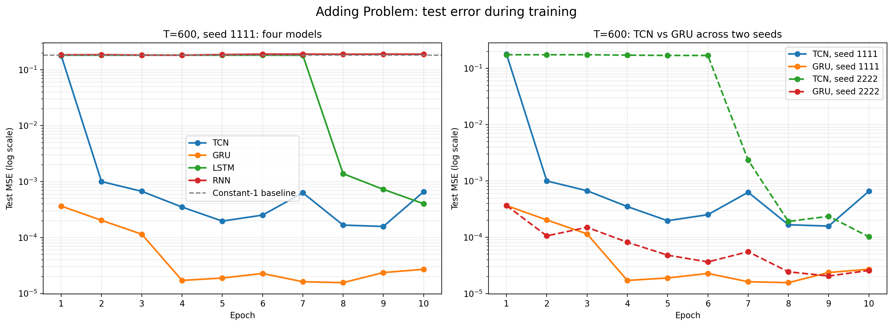

# TCN Reproduction: Adding Problem · Copy Memory

[](https://colab.research.google.com/github/chamelewan/tcn-reproduction/blob/main/notebooks/TCN_01_Adding_Problem.ipynb)

Google Colab에서 **locuslab/TCN의 Adding Problem과 Copy Memory**를 실행하고 로그와 결과를 정리한 재현 기록입니다. 2026-11-10의 T=200·400 초기 실행과 2026-11-24의 T=600 및 순환신경망 기준 모델 실험, Copy Memory T=1000 실험을 포함합니다. 원 논문 전체 벤치마크 또는 O-RAN 트래픽 예측을 재현한 저장소는 아닙니다.

## 원본 연구

- Bai, Kolter, Koltun (2018), *An Empirical Evaluation of Generic Convolutional and Recurrent Networks for Sequence Modeling*
- [논문](https://arxiv.org/abs/1803.01271) · [원본 저장소](https://github.com/locuslab/TCN)
- 사용 커밋: `2f8c2b817050206397458dfd1f5a25ce8a32fe65`
- 원본 코드는 MIT 라이선스이며 [원본 LICENSE](https://github.com/locuslab/TCN/blob/2f8c2b817050206397458dfd1f5a25ce8a32fe65/LICENSE)를 따릅니다. 원본 모델·학습 소스를 복사하지 않고 노트북에서 해당 커밋을 내려받습니다.

## 실행 방법

1. 위 **Open in Colab** 버튼으로 노트북을 엽니다. 수정하려면 본인 Drive에 사본을 저장합니다.
2. **런타임 → 런타임 유형 변경 → NVIDIA GPU**를 선택합니다. 기록된 실행 장치는 L4입니다.
3. `TCN_01_Adding_Problem.ipynb`의 코드 셀을 위에서 아래로 실행합니다. 맥에서는 셀 왼쪽 ▶ 또는 **Shift + Return**을 사용합니다.
4. 환경 확인 → 원본 커밋 체크아웃 → GPU 순전파 → T=200 학습 → T=400 학습 → 로그 ZIP → 비교 그래프 순서입니다.
5. 로그·그래프는 `/content/TCN/reproduction_logs/`에 생성됩니다. 임시 파일이므로 다운로드 셀로 보관합니다.

필요한 Python 패키지는 PyTorch, NumPy, Matplotlib입니다. 기록된 Colab 환경에서는 별도 설치 없이 사용했습니다. 현재 런타임의 버전은 환경 확인 셀에서 확인하세요. 버전 차이에 따른 완전한 수치 일치는 보장하지 않습니다.

## 실험 환경과 조건

실행일: 2026-11-10. Python **3.13.16**, PyTorch **2.14.1+cu130**, GPU **NVIDIA L4**. NumPy·Matplotlib의 실행 당시 버전은 기록하지 않았습니다.

공통 설정: 학습 50,000개 / 테스트 1,000개, 배치 32, 커널 7, 블록당 채널 30, dropout 0, Adam, 학습률 0.004, 3에폭. PyTorch·NumPy 시드 모두 1111입니다. 원본 학습 파일은 수정하지 않고 실행 래퍼에서 NumPy 시드를 추가했습니다. GPU 결정적 연산 모드를 별도로 강제하지 않았습니다.

Adding Problem은 난수 채널과 두 위치를 표시하는 마커 채널을 입력받아, 표시된 두 난수의 합을 예측하는 인공 과제입니다.

## 결과

| 조건 | 블록 수 | 수용 영역 | Epoch 1 Test MSE | Epoch 2 Test MSE | Epoch 3 Test MSE (최종) | 전체 실행 시간 |
| --- | ---: | ---: | ---: | ---: | ---: | --- |
| T=200 | 7 | 1,525 | 0.001812 | 0.000285 | **0.000531** | 미측정 |
| T=400 | 8 | 3,061 | 0.166145 | 0.001375 | **0.002161** | 62.5초 |

두 프로세스 모두 종료 코드 0으로 정상 종료됐습니다. T=400 시간은 데이터 생성·모델 구성·학습·평가 등을 포함한 전체 프로세스 경과 시간입니다.


- 왼쪽은 로그의 학습 구간 손실입니다. 가로축은 실제 시간이 아닌 에폭 진행량입니다.
- 오른쪽은 에폭 종료 시 측정한 테스트 값 3개입니다. 연결선 중간을 평가한 것은 아닙니다.
- 두 세로축은 로그 눈금입니다. T=200은 1에폭 후반, T=400은 2에폭 중반에 급격한 오차 감소를 보였습니다.
- 두 조건 모두 2에폭의 Test MSE가 최저이고 3에폭에는 상승했습니다. 단일 실행만으로 과적합을 확정하지 않습니다.

## 재현 범위와 한계

- 길이와 블록 수가 함께 바뀌어 **길이만의 효과를 분리한 실험이 아닙니다.** 단일 실행이며 평균·표준편차는 없습니다.
- 원본은 같은 테스트셋을 매 에폭 평가합니다. 최종값과 최저 관측값을 구분하며 별도 검증셋으로 최적 에폭을 선택한 실험은 아닙니다.
- 학습 가중치·최적 체크포인트는 저장하지 않았습니다. 로그와 그래프만 포함합니다.
- `weight_norm` FutureWarning이 발생했으나 실행은 완료됐습니다. 원본 API를 유지했습니다.
- 저장된 출력은 실제 Colab 실행에서 얻었습니다. 게시용으로 커밋 고정, 생성된 로그 경로 자동 전달, 학습 프로세스 오류 검사와 설명을 추가하고 다운로드 UI 임시 출력을 제거했습니다. 학습 설정과 기존 수치는 유지했습니다.
- **게시용 정리 후 전체 GPU 학습은 다시 실행하지 않았습니다.** Python 셀 구문 검사와 저장 로그 평가값 확인을 수행했습니다. 기존 수치를 새 코드 실행 결과로 주장하지 않습니다.

## 파일 구성

```text
notebooks/TCN_01_Adding_Problem.ipynb  # 실행 셀과 저장된 과거 결과
logs/                               # 두 실행의 텍스트 로그
results/adding_T200_T400_comparison.png
```

현재 결과를 출발점으로 논문 설정 대조, 추가 길이 조건, 반복 실행 등을 이어갈 예정입니다.

## 2026-11-24: T=600 및 기준 모델 비교

추가 실험은 NVIDIA T4에서 진행했습니다. 원본 TCN 커밋은 위와 같으며, T=600 모델은 논문 부록의 커널 8·블록 8·채널 24 설정을 사용했습니다. 모델 파라미터는 70,369개입니다. 학습 50,000개·테스트 1,000개, 배치 32, Adam 학습률 0.004, dropout 0, 손실 함수 MSE입니다. NumPy와 PyTorch에 동일한 시드를 설정했습니다. 원본 TCN 스크립트의 `--cuda` 옵션은 역으로 CPU를 선택하므로 GPU 실행 시 전달하지 않습니다.

GRU·LSTM·RNN은 **논문 저자의 공개 구현이 아닌 직접 구성한 단일 계층 기준 모델**입니다. 원본 `data_generator`를 사용했고, 모델 크기를 약 7만 파라미터로 맞췄습니다. 같은 시드의 모델은 동일한 난수 생성 순서로 만든 학습·테스트 데이터를 사용하도록 했습니다. GPU 결정적 연산 모드는 강제하지 않았으므로 같은 시드로 재실행해도 결과가 정확히 일치하지 않을 수 있습니다.

| 시드 | 모델 | 파라미터 | 3에폭 테스트 MSE | 10에폭 테스트 MSE |
| --- | --- | ---: | ---: | ---: |
| 1111 | TCN | 70,369 | 0.000671 | 0.000659 |
| 1111 | GRU | 69,451 | 0.000115 | 0.000027 |
| 1111 | LSTM | 69,811 | 0.181890 | 0.000403 |
| 1111 | RNN | 69,955 | 0.182912 | 0.189242 |
| 2222 | TCN | 70,369 | 0.175058 | 0.000102 |
| 2222 | GRU | 69,451 | 0.000150 | 0.000026 |

표의 TCN 3에폭 값은 **각 10에폭 실행의 세 번째 평가값**입니다. 별도로 수행한 3에폭 실행의 최종값은 시드 1111에서 0.001388, 시드 2222에서 0.175206이었습니다. 최종값과 실행 중 최저값을 구분합니다. 예를 들어 시드 1111의 TCN은 9에폭 0.000158이었으나 10에폭 최종값은 0.000659입니다. 별도 검증셋으로 에폭을 선택하지 않았고 같은 테스트셋을 매 에폭 평가했습니다.

시드 1111의 LSTM은 8에폭, 시드 2222의 TCN은 7에폭부터 오차가 크게 감소했습니다. RNN은 10에폭 후에도 거의 일정한 값만 예측했습니다. 두 시드의 TCN·GRU 비교에서 GRU가 더 낮은 최종 오차를 냈습니다. 이 결과는 이 합성 과제·직접 구성한 기준 모델·제한된 시드와 학습 설정에만 해당합니다. 논문의 순환신경망 결과나 O-RAN 트래픽 예측의 재현으로 해석하지 않습니다.



`notebooks/TCN_20261124_session_archive.ipynb`는 **실제 Colab 세션에서 내려받은 실행 기록**입니다. 11월 10일 셀과 11월 24일 셀이 이어 붙어 있으며, 중간에 같은 저장소를 다시 복제하는 셀이 있으므로 처음부터 **모두 실행**하지 마세요. 저장된 출력은 실제 실행 결과지만, GitHub에 올린 뒤 다시 GPU로 전체 실행하지는 않았습니다.

순환신경망 기준 모델을 새 런타임에서 실행할 때는 원본 저장소를 해당 커밋으로 복제한 뒤 이 저장소의 스크립트를 사용합니다. 이 스크립트는 세션의 학습 코드를 정리한 것이며 게시 후 GPU 재실행은 아직 하지 않았습니다.

```bash
git clone https://github.com/locuslab/TCN.git /content/TCN
git -C /content/TCN checkout 2f8c2b817050206397458dfd1f5a25ce8a32fe65
git clone https://github.com/chamelewan/tcn-reproduction.git /content/tcn-reproduction
python /content/tcn-reproduction/scripts/run_t600_recurrent.py --repo /content/TCN --model GRU --seed 1111 --epochs 10
```

`--model`은 `GRU`, `LSTM`, `RNN` 중 하나입니다. 시드 2222 GRU 실행은 `--seed 2222`를 사용합니다. 원본 TCN 실행 코드는 세션 기록 노트북에 있습니다. `logs/`에는 T=600 TCN의 원본 출력, `results/`에는 순환신경망의 에폭별 JSON과 비교 CSV·PNG를 보관합니다. 학습 가중치 체크포인트는 사용자의 별도 로컬 ZIP 백업에 있으며 이 공개 저장소에는 넣지 않았습니다.

## 2026-11-24: Copy Memory T=1000

[](https://colab.research.google.com/github/chamelewan/tcn-reproduction/blob/main/notebooks/TCN_02_Copy_Memory.ipynb)

Copy Memory는 입력 앞쪽의 숫자 10개를 기억했다가 길이 T의 빈 구간 뒤에 그대로 다시 출력하는 합성 과제입니다. T=1000이면 전체 길이는 1,020이고, 정답 1,020칸 중 1,010칸이 0입니다. 따라서 **전부 0만 예측해도 전체 정확도는 약 99.02%**이므로 마지막 10칸 정확도를 따로 계산했습니다.

실행 장치는 NVIDIA Tesla T4입니다. 원본 `TCN.copy_memory.copymem_test`를 수정하지 않고 `runpy` 래퍼로 실행했으며, 래퍼에서 NumPy 시드를 추가했습니다. 설정: 시드 1111, 커널 8, 블록 8, 채널 10, dropout 0.05, RMSprop 학습률 0.0005, 배치 32(원본 기본값). GPU 결정적 연산 모드는 강제하지 않았습니다.

| 실행 | 파라미터 | 최종 전체 테스트 손실 | 실행 중 최저 손실 | 최종 전체 정확도 | 최종 마지막 10칸 정확도 | 전체 실행 시간 |
| --- | ---: | ---: | ---: | ---: | ---: | --- |
| 10에폭 예비 실행 | 12,530 | 0.00439484 | 0.00439484 (10에폭) | 99.9247% | 미측정 | 48.0초 |
| 50에폭 (처음부터) | 12,530 | **0.00024682** | 0.00008991 (49에폭) | 100.0000% | **100.0000%** | 188.6초 |

- 50에폭 실행은 10에폭 실행을 이어 학습한 것이 아니라 **처음부터 다시 실행**했습니다. 원본 코드가 체크포인트를 저장하지 않기 때문입니다.
- 마지막 10칸만의 cross-entropy는 0.02515841입니다. 정답 숫자를 모두 맞혀도 확률이 정확히 1은 아니므로 정확도 100%와 양립합니다.
- 테스트 손실은 에폭마다 흔들렸습니다. 최종값(50에폭)과 실행 중 최저값(49에폭)을 구분하며, 별도 검증셋으로 에폭을 선택하지 않았습니다.
- 원 논문 Table 1의 Copy Memory T=1000 TCN 손실은 3.5e-5입니다. 이번 최종 손실은 그보다 높습니다. 논문 모델은 약 16K 파라미터로 기재되어 있고 원본 코드 기본값 모델은 12,530개여서 조건이 완전히 같지 않습니다.
- 원본 `copymem_test.py`의 학습 루프는 `clip_grad_norm_`을 `loss.backward()`보다 **먼저** 호출합니다(119–121행). 따라서 로그의 `clip=1.0`만으로 그래디언트 클리핑이 실제로 적용됐다고 보지 않습니다. 코드는 원본 그대로 실행했습니다.
- 단일 시드·단일 실행이며 순환신경망 기준 모델과의 Copy Memory 비교는 아직 하지 않았습니다.


그래프는 50에폭 로그에서 `scripts/plot_copy_memory.py`로 생성했습니다. 왼쪽은 전체 테스트 손실(로그 눈금), 오른쪽은 전체 정확도와 '전부 0 예측' 기준선(99.02%)입니다.

```bash
python scripts/plot_copy_memory.py logs/copy_memory_T1000_seed1111_50epochs_20261124_051148.log results/copy_memory_T1000_seed1111_50epochs.png
```

`notebooks/TCN_02_Copy_Memory.ipynb`는 실제 Colab 세션에서 내려받은 실행 기록입니다. 게시 시 파일 다운로드 UI의 임시 출력만 제거했고 코드와 학습 출력은 그대로입니다. 노트북 출력의 평가값 60개(10에폭 10개, 50에폭 50개)는 `logs/`의 두 로그와 일치함을 확인했습니다. 게시 후 GPU 재실행은 하지 않았습니다. 50에폭 체크포인트는 사용자의 로컬 ZIP 백업에만 있고 이 저장소에는 넣지 않았습니다.
